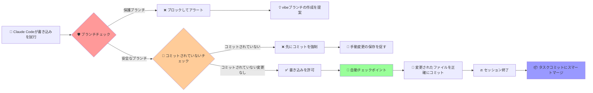

<div align="center">

# 🛡️ Claude Code ガードレール

<p align="center">
  <strong>より安全なClaude Code開発のためのスマートガードレールシステム</strong>
</p>

<p align="center">
  <a href="https://github.com/wangbooth/claude-code-guardrails/stargazers">
    
  </a>
  <a href="https://github.com/wangbooth/claude-code-guardrails/forks">
    
  </a>
  <a href="https://github.com/wangbooth/claude-code-guardrails/blob/main/LICENSE">
    
  </a>
  <a href="https://github.com/wangbooth/claude-code-guardrails/issues">
    
  </a>
</p>

<p align="center">
  <strong>🔥 このプロジェクトが役に立ったら、右上の ⭐ スターをクリックして応援してください！</strong>
</p>

<p align="center">
  <a href="README.md">🇺🇸 English</a> | <a href="README_CN.md">🇨🇳 中文</a> | <a href="README_JA.md">🇯🇵 日本語</a>
</p>

</div>

---

## 🚨 ペインポイント：Claude Codeの「危険な瞬間」

Vibe Codingをしていて、こんなイライラする場面に遭遇したことはありませんか？

❌ **mainブランチへの直接変更** → 一つのミスで重要なコードが上書きされる  
❌ **中断された変更** → 中間成果物が失われ、特定の状態にロールバックできない  
❌ **混沌とした複数の変更** → どの変更がバグを引き起こしたのか分からない  
❌ **重要なファイルを誤って削除** → タイムリーなコミットがなく、ゲームオーバー  
❌ **手動変更の上書き** → AIがコミットされていない手動変更を直接上書き、コードの所有権を区別できない  

## 💡 解決策：Claude Code ガードレール

**Claude Code Hookに基づくガードレール**

> **3重セキュリティメカニズム**: 🛡️ **書き込み前の遮断アラート** + 📸 **精密なスナップショットコミット** + 🔄 **スマートマージアーカイブ**

✅ **保護ブランチの遮断** → mainブランチへの書き込みを自動的にブロック、フィーチャーブランチの作成を提案  
✅ **コミットされていない変更の保護** → 手動変更がコミットされていない場合はブロック、上書きを避けるため先にコミットを強制  
✅ **ファイルレベルの精密なスナップショット** → 各変更で変更されたファイルのみをコミット、ノイズを回避  
✅ **スマートバックアップメカニズム** → gitignoreファイル変更前の自動バックアップ  
✅ **安全な履歴マージ** → 複数のチェックポイントをクリーンなタスクコミットにインテリジェントにマージ

<div align="center">

### 🎉 今すぐ体験を開始！

<p>
  <a href="#-クイックスタート">
    
  </a>
  &nbsp;&nbsp;
  <a href="https://github.com/wangbooth/claude-code-guardrails/stargazers">
    
  </a>
</p>

</div>

---

## ✨ コア機能

<table>
<tr>
<td width="50%">

### 🛡️ 二重セキュリティ保護
- **保護ブランチの遮断** 
- **コミットされていない変更の検出**
- 書き込み前のブロックアラート
- `vibe`ブランチ作成のスマート提案
- 続行前に手動変更の強制コミット

</td>
<td width="50%">

### 📸 精密なスナップショット
- **ファイルレベルのスナップショットコミット**
- `git add .`からのノイズを回避
- 現在変更されたファイルのみをコミット
- 完全な変更履歴を保持

</td>
</tr>
<tr>
<td width="50%">

### 🔄 スマートバックアップ
- **gitignoreファイルの自動バックアップ**
- 変更前に`.claude/backups/`にバックアップ
- バイリンガルのフレンドリーなリマインダー
- 重要な設定ファイルの損失を防止

</td>
<td width="50%">

### 📦 履歴の整理
- **安全なスカッシュマージ**
- 複数のチェックポイントをタスクにマージ
- 保護ブランチの履歴を壊さない
- Git履歴をクリーンに保つ

</td>
</tr>
</table>

### 🔧 完璧な互換性
- ✅ **既存のClaude Code Hooksを上書きしない** - `.claude/settings.json`をインテリジェントにマージ
- ✅ **バックアップ + 重複排除 + 冪等性** - 複数インストールでも安全
- ✅ **ユーザーフックと共存** - 既存のワークフローに影響しない

---

## 🆚 他のソリューションとの比較

<table>
<tr>
<th width="25%">ソリューション</th>
<th width="25%">従来のアプローチ</th>
<th width="25%">手動バックアップ</th>
<th width="25%"><strong>🛡️ ガードレール</strong></th>
</tr>
<tr>
<td><strong>ブランチ保護</strong></td>
<td>❌ 人間の記憶に依存</td>
<td>❌ 事後の修復措置</td>
<td>✅ 自動遮断アラート</td>
</tr>
<tr>
<td><strong>バージョン追跡</strong></td>
<td>❌ 中間状態を失う</td>
<td>⚠️ 手動のコピーペースト</td>
<td>✅ 精密な自動スナップショット</td>
</tr>
<tr>
<td><strong>履歴の整理</strong></td>
<td>❌ 乱雑なコミット記録</td>
<td>❌ 追跡不可能</td>
<td>✅ スマートマージアーカイブ</td>
</tr>
<tr>
<td><strong>使いやすさ</strong></td>
<td>⚠️ 経験が必要</td>
<td>❌ 面倒でエラーが発生しやすい</td>
<td>✅ ワンクリックでインストールして使用</td>
</tr>
</table>

---

## 🧰 前提条件

* **Git** がインストールされ初期化されている（`user.name` / `user.email`が設定済み）
* **Claude Code** がインストールされている（Hooksと`PreToolUse exit=2`ブロッキングをサポートするバージョン）
* **jq**（Hook入力JSONを解析するため）

  * macOS: `brew install jq`
  * Ubuntu: `sudo apt-get install -y jq`

---

## 🚀 クイックスタート

<div align="center">

### 🎯 インストール方法を選択

</div>

<table>
<tr>
<td width="50%">

### 🌟 推奨：ワンクリックインストール
**スマートマージ、安全で心配なし**

```bash
# プロジェクトレベルのインストール
curl -fsSL https://raw.githubusercontent.com/wangbooth/claude-code-guardrails/main/install.sh | bash
```

```bash
# グローバルインストール
curl -fsSL https://raw.githubusercontent.com/wangbooth/claude-code-guardrails/main/install.sh | bash -s -- --global
```

</td>
</tr>
</table>

<table>
<tr>
<td width="50%">

### 📁 方法2：手動コピー
**直感的で透明、完全制御**

```bash
cp -r .claude/ /path/to/your-project/
chmod +x /path/to/your-project/.claude/hooks/guardrails/*.sh
```

</td>
</tr>
</table>

<div>

### ✨ インストールスクリプトの機能

🔄 **スマートマージ** - 既存の設定を上書きしない  
💾 **自動バックアップ** - 変更前にsettings.jsonをバックアップ  
🔁 **冪等性の安全性** - 複数実行しても副作用なし  
🧹 **重複排除** - 重複する設定項目を回避

</div>

---

## 🗑️ アンインストール

```bash
# プロジェクトレベルのアンインストール
curl -fsSL https://raw.githubusercontent.com/wangbooth/claude-code-guardrails/main/uninstall.sh | bash

# スクリプトファイルを保持、settings.jsonからのみ削除
curl -fsSL https://raw.githubusercontent.com/wangbooth/claude-code-guardrails/main/uninstall.sh | bash -s -- --keep-scripts

# グローバルアンインストール
curl -fsSL https://raw.githubusercontent.com/wangbooth/claude-code-guardrails/main/uninstall.sh | bash -s -- --global
```

---

## 🗂️ ディレクトリ構造

```
.
├─ .claude/
│  ├─ settings.json                 # Hookエントリーとマッチングルール（テンプレート）
│  └─ hooks/
│     ├─ guardrails/
│     │  ├─ guard-branch.sh         # 書き込み前ブランチガード（保護ブランチブロッキング）
│     │  ├─ auto-commit.sh          # 変更ごとの精密スナップショットコミット
│     │  └─ squash-checkpoints.sh   # Stop/Compactステージの安全なマージ
├─ install.sh                       # ワンクリックインストール（マージ/バックアップ/重複排除/冪等性）
├─ uninstall.sh                     # ワンクリックアンインストール（スクリプト保持可能）
├─ README.md
├─ LICENSE                          # MIT
```

---

## 📺 効果のデモ

<div align="center">

### 🎬 ワークフローの概要



</div>

## 🧪 使用例

### シナリオ1：保護ブランチの遮断

保護ブランチで書き込みを試行 → **ブロックしてアラート**、ターミナルが`vibe`ブランチの作成を提案：

```
⚠️  Branch 'main' is protected.
   Current branch 'main' is protected.

It's recommended to create/switch to a vibe branch before making changes:
建议创建/切换到 vibe 分支再修改，例如：
  git checkout -b vibe/20250811142530-claude
```

### シナリオ2：コミットされていない変更の保護

コミットされていない手動変更を検出 → **ブロックして先にコミットを促す**：

```
⚠️  Detected uncommitted changes in the repository.
   检测到仓库中有未提交的更改。

There are uncommitted changes that may be lost if AI overwrites them.
存在未提交的更改，如果被 AI 覆盖可能导致代码丢失。

Consider committing these changes first:
建议先提交这些更改：
  git add .
  git commit -m "Save work in progress"
```

### シナリオ3：通常のワークフロー

vibeブランチに切り替えて作業を継続 → 各`Write/Edit/MultiEdit`後に自動チェックポイント：

```
checkpoint: Write src/LoginForm.tsx - 14:25
checkpoint: Edit src/types.ts - 14:26
```

   gitignoreファイルを変更する場合、バックアップリマインダーを受け取ります：
   
```
📦 Backup Notice: '.env' is a gitignored file. A backup has been saved to '.claude/backups/.env.20250811-142530' before claude code modification.
📦 备份提醒: '.env' 是 gitignore 文件，claude code 修改前已备份到 '.claude/backups/.env.20250811-142530'
```

### シナリオ4：セッション終了の整理

セッション終了`stop` / `compact`トリガー → 複数のチェックポイントを自動的に**1つのタスクコミットにマージ**：

```
task: modify LoginForm.tsx, types.ts - 2025-08-11
```

---

## 🛡️ セキュリティ戦略とベストプラクティス

* **ブランチ保護**: デフォルトで`main|master|dev|release*`を保護、`guard-branch.sh`で調整可能。
* **公開履歴を壊さない**: 保護ブランチではスカッシュしない；「アップストリームなしまたはahead>0」の場合のみチェックポイントをマージ。
* **コラボレーション推奨**: リモートブランチ保護（強制プッシュなし/PR必須）と組み合わせるとより安定。

---

## 🔧 カスタマイズガイド

* **コミットメッセージ規則**: `auto-commit.sh`を`chore(checkpoint): ...`に変更；Stopステージは`vibe/fix/...`タイプを出力（Conventional Commits）。
* **より厳格な書き込みパス**: 「直接ファイル書き込みツール」を完全に防ぐには、`PreToolUse`でカスタムMCP書き込みツールのみを許可し、汎用的な`Write|Edit|MultiEdit`をブロック。
* **外部統合**: `PostToolUse`または`Stop`でCLI/APIを呼び出す（チケット、PR、メッセージ通知など）。

---

## ❓ よくある質問（FAQ）

**Q: 既存のフックを上書きしますか？**

A: いいえ。インストールスクリプトは`jq`を使用して`.claude/settings.json`を**マージ**し、同じ`matcher`に対して**追加と重複排除**のみを行います；書き戻す前に`.bak.*`バックアップを生成します。

**Q: 手動でコードを変更したがまだコミットしていない場合、Claude Codeは作業を続けることができますか？**

A: いいえ。guard-branch.shはコミットされていない変更を検出して操作をブロックし、先にコミットするよう促します。これにより、AIが手動変更を上書きすることを防ぎ、コードの所有権が明確で追跡可能になります。

**Q: 複数のフックは順番に実行されますか？**

A: 同じイベントにマッチする複数のフックは**並列**で実行されます；厳密な順序が必要な場合は、同じスクリプトに複数のコマンドを記述してシリアル実行します。

**Q: Windowsをサポートしていますか？**

A: スクリプトはPOSIXシェルベースです。WindowsユーザーはWSLまたはUnix系環境の使用を推奨します。

---

## 🌟 コミュニティサポート

<div align="center">

### 💝 役に立ちましたか？サポートしてください！

<p>
  <a href="https://github.com/wangbooth/claude-code-guardrails/stargazers">
    
  </a>
  &nbsp;&nbsp;
  <a href="https://github.com/wangbooth/claude-code-guardrails/fork">
    
  </a>
</p>

<p>
  <strong>⚡ トリプルアクション: スター ⭐ + フォーク 🍴 + シェア 📢</strong>
</p>

### 🤝 貢献

<table>
<tr>
<td align="center" width="33%">

**🐛 バグを見つけた**
<br/>
[Issue提出](https://github.com/wangbooth/claude-code-guardrails/issues/new)

</td>
<td align="center" width="33%">

**💡 機能提案**
<br/>
[機能リクエスト](https://github.com/wangbooth/claude-code-guardrails/issues/new)

</td>
<td align="center" width="33%">

**🔀 コード貢献**
<br/>
[PR提出](https://github.com/wangbooth/claude-code-guardrails/pulls)

</td>
</tr>
</table>

### 📊 プロジェクト統計

<p>
  
  
  
</p>

</div>

---

## 📄 ライセンス

<div align="center">

このプロジェクトは**MITライセンス**の下でライセンスされています。詳細は[LICENSE](LICENSE)ファイルを参照してください

**⭐ このプロジェクトが役に立ったら、スターをクリックして応援してください！ ⭐**

</div>

---

<div align="center">

**🛡️ Chase the vibe, but honor the craft. 🛡️**

</div>
